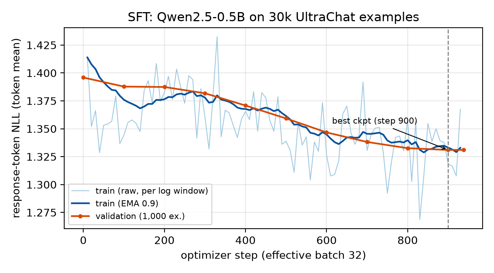
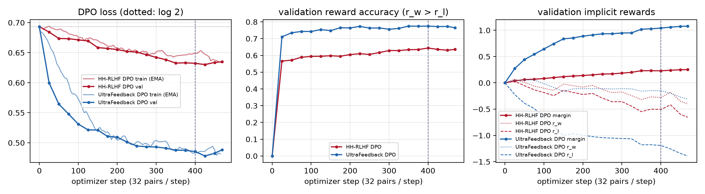

# Instruction Tuning and DPO on Qwen2.5-0.5B

*Draft. Every `[[...]]` placeholder must be filled from `report/results.md` and `report/figures/` after the
runs; nothing in those slots is a measured result yet. Export to PDF (≤ 8 pages), for example with
`pandoc report.md -o report.pdf`.*

## 1. Repository, models, and data (§14.1)

- **Repository:** [[GitHub URL]]
- **Base checkpoint:** `Qwen/Qwen2.5-0.5B` for SFT and both from-scratch DPO runs;
  `HuggingFaceTB/SmolLM2-360M-Instruct` for LoRA-DPO.
- **Seeds:** 42 everywhere (data shuffles, AlpacaEval subset, DataLoader order, model init of LoRA, A/B order of
  pairs).
- **Prompt format:** Qwen ChatML with system message `You are a helpful assistant.`. The response is followed by
  `<|endoftext|>` (EOS), and generation stops on `<|im_end|>` or `<|endoftext|>` (`sma/prompts.py`). LoRA-DPO
  uses SmolLM2's own chat template through TRL's conversational format.
- **Decontamination:** training prompts that exactly match (after normalization) an AlpacaEval-300 or
  HH-eval-300 instruction are removed.

| Track | Source | Filtering | Train / val |
|---|---|---|---|
| SFT | `HuggingFaceH4/ultrachat_200k` `train_sft` / `test_sft`, first user and assistant turn | prompt ≤ 256 tokens; prompt + response + EOS ≤ 512 tokens, so no example loses its EOS | 30,000 / 1,000 |
| HH-DPO | `Anthropic/hh-rlhf` `harmless-base` + `helpful-base` (train / test) | single-turn only (24,971 of 86,372 train rows); chosen ≠ rejected; prompt ≤ 256 tokens; 50/50 harmless/helpful | 15,000 / 1,000 |
| UF-DPO | `HuggingFaceH4/ultrafeedback_binarized` `train_prefs` / `test_prefs` | single-turn; score_chosen − score_rejected ≥ 1; prompt ≤ 256 tokens | 15,000 / 1,000 |
| LoRA-DPO | `data/persona_lora/ramsay_style_preferences.json` (220 pairs) | seeded 90/10 split | 198 / 22 |

| Evaluation set | Used for |
|---|---|
| `eval_sets/alpaca_eval_300_seed42.json`: 300 of 805 AlpacaEval prompts, `random.Random(42).sample` | UF-DPO vs SFT |
| `eval_sets/hh_rlhf_eval_300_seed42.json`: 300 prompts, 10 categories × 30 (provided) | HH-DPO vs SFT |
| `eval_sets/persona_style_eval_40.json`: 10 cooking, 10 coding, 10 general-help, 10 safety-sensitive (ours) | LoRA-DPO vs SmolLM2-Instruct |

Exact filter counts are in `outputs/data/data_stats.json`.

## 2. Experimental configuration (§14.2)

| | SFT | HH-DPO | UF-DPO | LoRA-DPO |
|---|---|---|---|---|
| Trainable params | full FT (494M) | full FT | full FT | LoRA r=16, α=32, dropout 0.05; q,k,v,o,gate,up,down ([[N]] params, [[%]]) |
| Optimizer | AdamW (0.9, 0.999), eps 1e-8 | AdamW | AdamW | AdamW (TRL default) |
| Peak LR / schedule | 2e-5, cosine to 0, 3% warmup | 1e-6 constant, no warmup | 1e-6 constant, no warmup | 5e-5, cosine, 10% warmup |
| Weight decay | 0.1 (none on norms, biases, embeddings) | 0 | 0 | 0 |
| Grad clip | 1.0 | 1.0 | 1.0 | 1.0 |
| Micro-batch × accum = effective | 16 × 2 = 32 | 4 pairs × 8 = 32 pairs | 4 pairs × 8 = 32 pairs | 4 × 2 = 8 |
| Precision | bf16 autocast, FP32 master weights | same | same | bf16 (TRL) |
| Max length / max prompt | 512 / 256 (filter) | 512 / 256 | 512 / 256 | 512 / 256 |
| Epochs / optimizer steps | 1 / [[938]] | 1 / [[469]] | 1 / [[469]] | 3 / [[75]] |
| DPO β | n/a | 0.1 | 0.1 | 0.1 |
| Reference | n/a | frozen `outputs/sft/best` (step [[k]]) | frozen `outputs/sft/best` | base SmolLM2 with adapter disabled |
| Checkpoint selection | lowest val loss | highest val reward acc (tie: margin) | same | final adapter |
| Seed | 42 | 42 | 42 | 42 |
| Hardware | 1× H100 80GB (Modal) | same | same | same |

**Generation (all comparisons):** greedy (`do_sample=False`, so temperature and top-p are unused),
`max_new_tokens=512`, `repetition_penalty=1.1`, no n-gram blocking, bf16, left-padded batches of 50, and the same
settings for every model in a comparison. **Judge:** [[google/gemini-3.6-flash]] at temperature 0, 5 pairs per
request, 5 s sleep, ≤ 3 retries, both A/B orders.

## 3. Parameter choices and deviations (§14.3)

| Change | Guide | Ours | Type | Why / effect |
|---|---|---|---|---|
| Hardware | Kaggle T4 × 2, fp16 + GradScaler | Modal H100, bf16 autocast (fp16 path kept: `--precision fp16`) | resource | bf16 has fp32 range, so no loss scaling or overflow skips; FP32 master weights unchanged. |
| SFT micro-batch | 2 × 16 | 16 × 2 | resource | Same effective batch of 32. Loss is normalized by the token count of the whole window, so the gradient matches the guide's (tested in `test_grad_accumulation_*`). |
| DPO micro-batch | 1 × 32 | 4 × 8 | resource | Same 32 pairs per step; per-pair mean reweighted across micro-batches. |
| DPO optimizer | RMSprop or AdamW | AdamW | design | Plain RMSprop has no bias correction: its second-moment estimate starts at 0, so the first updates are about 10× lr per parameter unless warmed up (the DPO paper used 150 warmup steps). AdamW avoids this at a fixed 1e-6. |
| Reference precision | fp16 reference on second GPU | FP32 weights + same autocast as policy, same GPU | design | Bit-identical policy and reference at step 0 (loss = log 2, rewards = 0), so reward diagnostics measure learning, not precision noise. |
| SFT data filter | none specified | drop examples that don't fit in 512 tokens | performance | Every target ends with EOS, so the model learns to stop. [[report mean length / % hitting max_new_tokens for SFT vs base]] |
| UF pair filter | none | score margin ≥ 1 | performance | Removes ties and near-ties, which are mostly label noise. |
| HH subsets | unspecified | harmless-base + helpful-base, 50/50, single-turn | design | The eval set is safety-heavy, but helpful pairs guard against over-refusal. |
| UF LR sweep (optional) | 1e-6 | 5e-7 / 1e-6 / 3e-6 | ablation | [[table: val reward acc, margin, mean output tokens, win rate vs SFT]] |

## 4. Training behavior (§14.4)

*Figure 1. SFT response-token NLL (token mean). Raw per-window train loss, EMA-smoothed with α = 0.9; validation
on 1,000 held-out examples every 100 steps. The dashed line marks the selected checkpoint.*

*Figure 2. DPO runs. Left: train loss (EMA 0.9) and validation loss; the dotted line is log 2. Middle: validation
reward accuracy (strict r_w > r_l). Right: margin, r_w and r_l. Dashed lines mark the selected checkpoints.*

[[Describe, for each figure, with numbers:]]
- SFT: val loss [[a → b]]; train and val gaps; whether the cosine tail flattens; selected step [[k]].
- DPO: accuracy starts at exactly 0 (all ties) and rises to [[x]] (HH) and [[y]] (UF). Report whether r_w and
  r_l both fall, which means the chosen log-prob also drops (likelihood displacement), using the logp columns in
  `results.md`. Selected steps are [[k]] and [[k]]. Training loss alone does not show response quality.
- LoRA-DPO (`figures/lora_dpo_curves.png`): with only 22 validation pairs, reward accuracy saturates quickly, so
  margin is the more informative signal.

## 5. DPO-versus-SFT results (§14.5)

[[Paste the main table from `report/results.md`: n, W/T/L, unknown, failures, win rate with and without ties,
ties counted as ½ with bootstrap 95% CI, and position consistency.]]

| Comparison (eval set) | n | W | T | L | Win rate | Win rate excl. ties | Ties = ½ (95% CI) | Fail / unknown |
|---|---|---|---|---|---|---|---|---|
| UF-DPO vs SFT (AlpacaEval-300) | 300 | | | | | | | |
| HH-DPO vs SFT (HH-eval-300) | 300 | | | | | | | |

Judge: [[model]]. Both A/B orders are judged; when the two orders disagree, the pair counts as a tie. Unresolved
items after 3 retries are listed separately and excluded from the rates. Position consistency: [[x%]].

**Persona track (reported separately):** LoRA-DPO vs SmolLM2-360M-Instruct on 40 prompts, with two criteria:
style faithfulness [[W/T/L]] and quality/safety [[W/T/L]], each broken down by category (cooking, coding,
general, safety).

**Additional analysis (not headline numbers):** HH-DPO vs SFT on AlpacaEval (alignment tax), UF-DPO vs SFT on
HH-eval (safety transfer), and SFT vs base on AlpacaEval.

## 6. Interpretation and error analysis (§14.6)

[[Answer explicitly: which model wins on each set and by how much (with CI); is the CI clear of 50%?]]

Questions to answer, each with numbers from `results.md`:
- **UF-DPO:** is the win concentrated in particular prompt types (AlpacaEval sources: selfinstruct, koala,
  oasst, helpful_base, vicuna)? How did length change (mean chars or tokens, candidate vs baseline), and did more
  responses hit `max_new_tokens`? Judges favor longer answers; the rubric tells the judge not to, but say whether
  wins track length.
- **HH-DPO:** use the per-category table. Expect gains in harmful_instructions, cyber_abuse, privacy, and hate,
  and possible losses in benign_helpfulness and calibration if the model over-refuses. HH "chosen" responses are
  short and often only mildly better, so the preference signal is noisy.
- **Measured vs interpreted:** relate the effect size to the reward diagnostics (final reward accuracy and
  margin), β = 0.1, and the single epoch of about 470 steps at 1e-6 (a small KL budget: the policy stays close to
  SFT, so many ties are expected).
- **Examples:** 2–3 wins and 2–3 regressions per track (`results.md` lists candidates), each with a one-line
  explanation.
- **Persona:** did style improve without loss of quality, especially on the 10 safety-sensitive prompts?

## 7. Limitations and reproducibility (§14.7)

- Single seed. 300 prompts gives roughly ±5–6 pp CI on the win rate. One LLM judge, whose biases remain despite
  position swapping and the length instruction. The persona set (40) and its validation split (22) are small.
- Greedy bf16 decoding in length-sorted batches can produce tiny batch-composition differences. Settings are
  identical across the models compared.
- **Reproduce:** `modal run modal_app.py` (or `notebooks/kaggle_t4_pipeline.ipynb`), then
  `notebooks/kaggle_judge.ipynb`. Key paths: `configs/*.yaml`, `outputs/*/run_config.json`,
  `outputs/*/metrics.jsonl`, `outputs/generations/{alpaca,hh,persona}/*.json` (+ `.meta.json`),
  `outputs/eval/*_pairs.jsonl`, `outputs/judged/*_judged.jsonl`, `*_summary.json`, `*_failures.jsonl`.

## References

Rafailov et al., *Direct Preference Optimization*, NeurIPS 2023. Ouyang et al., *InstructGPT*, NeurIPS 2022.
Bai et al., *HH-RLHF*, 2022. Dubois et al., *Length-Controlled AlpacaEval*, 2024. Zheng et al., *MT-Bench /
LLM-as-a-judge*, 2023. Hugging Face Transformers / TRL / PEFT docs. Kaggle Benchmarks docs.
